<p align="center">
  
</p>

<p align="center">
  <strong>An infinite 2D scrolling &amp; tiling window manager for Windows 10/11 — bringing Niri-style column stacks, Hyprscroll2D workspaces, and a live <code>Win+O</code> overview to keyboard-driven developers and power users.</strong>
</p>

<p align="center">
  
  
  <a href="https://github.com/fruitsaladwindowsai-zammy/Winscroller-2D/actions/workflows/ci.yml"></a>
  <a href="https://fruitsaladwindowsai-zammy.github.io/Winscroller-2D/"></a>
  <a href="https://github.com/fruitsaladwindowsai-zammy/Winscroller-2D/releases/latest"></a>
  
  
</p>

> 📖 **Official Documentation & Guides**:  
> Read the complete guides, multi-monitor configuration, and architecture internals:  
> [**fruitsaladwindowsai-zammy.github.io/Winscroller-2D**](https://fruitsaladwindowsai-zammy.github.io/Winscroller-2D/)

<p align="center">
  
</p>

```text
  ┌─────────────────── 2D Infinite Scrolling Workspace ───────────────────┐
  │                                                                        │
  │   [Peek]   ┌───────────────────────────┐   ┌──────────┐               │
  │   Editor   │   Terminal / IDE (Focus)  │   │ Browser  │  [Peek]       │
  │   (0, 0)   │          (1, 0)           │   │  (2, 0)  │               │
  │            └───────────────────────────┘   └──────────┘               │
  │            ┌───────────────────────────┐                              │
  │            │   Docs / Preview (1, 1)   │  ◄── Scroll smoothly in 2D   │
  │            └───────────────────────────┘      or press Win+O overview │
  └────────────────────────────────────────────────────────────────────────┘
```

## Live Demos & Visual Overview

### 🎬 Animated Walkthroughs

| Live 2D Overview (`Win + O`) | 2D Tiling & Split-Horizontal Snapping |
|:---:|:---:|
| 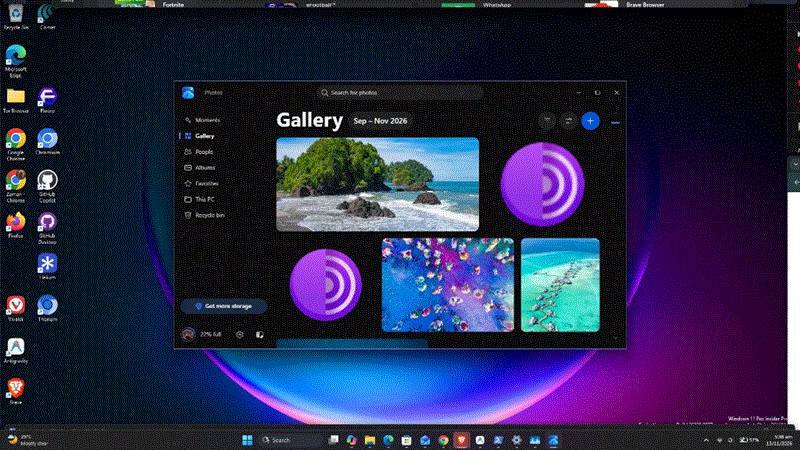 |  |
| *Zoom out into full 2D grid over acrylic blur, live DWM thumbnails & app badges* | *Infinite 2D scrolling, neighbor peeking, and drag-to-split dual-app views* |

---

### 📸 Screenshots Gallery

| Dynamic `Win + O` Overview | Centered Tiling with Infinite Canvas |
|:---:|:---:|
| 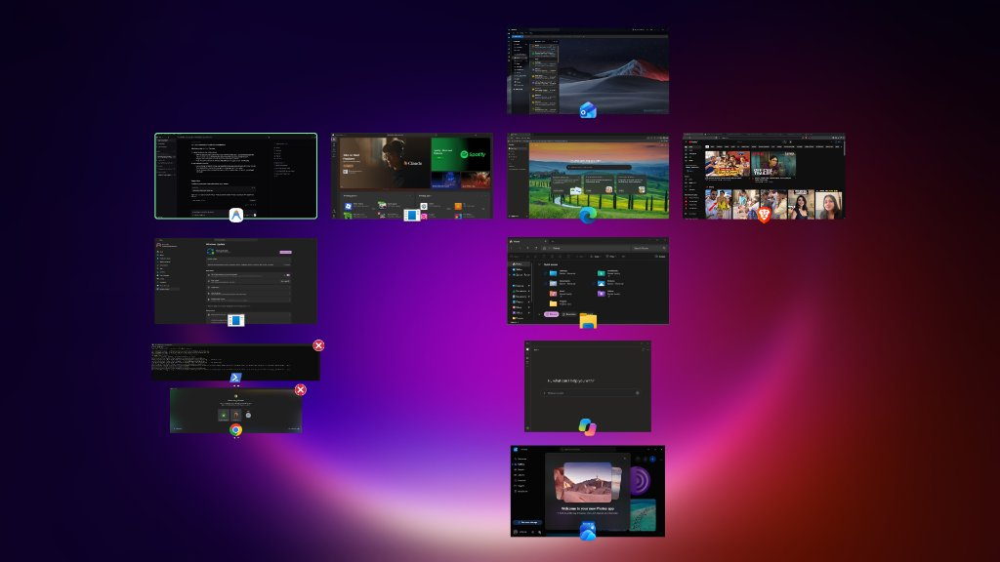 | 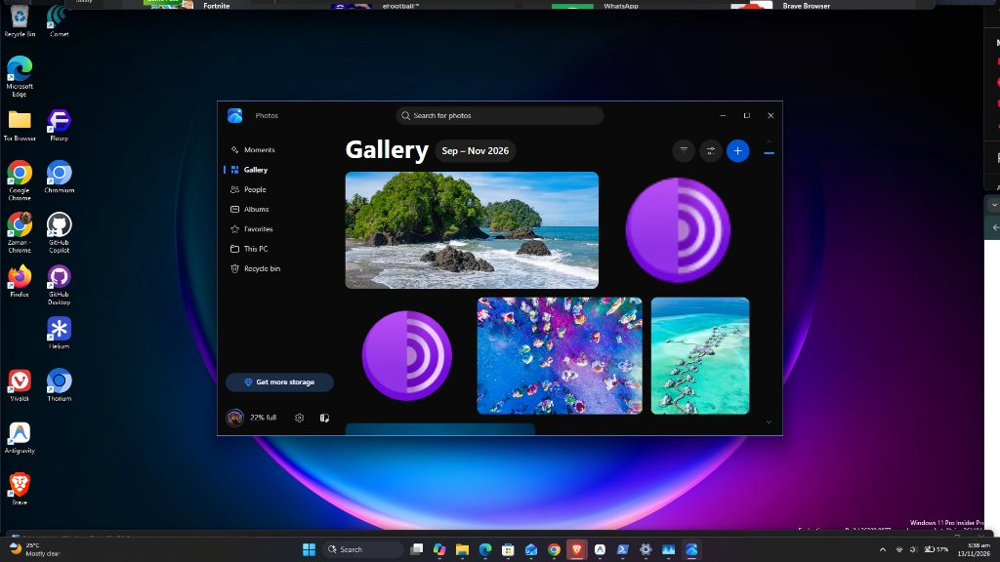 |

| Snapped Dual-App Horizontal Split | Layout Preset Selector HUD |
|:---:|:---:|
| 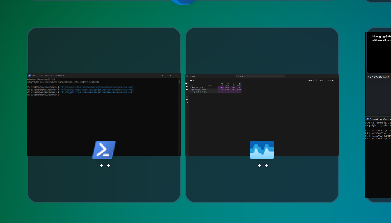 | 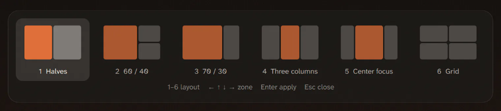 |

| Multi-Monitor Extended Mode (Zero Spillover) | 2D Infinite Scrolling Workspace |
|:---:|:---:|
| 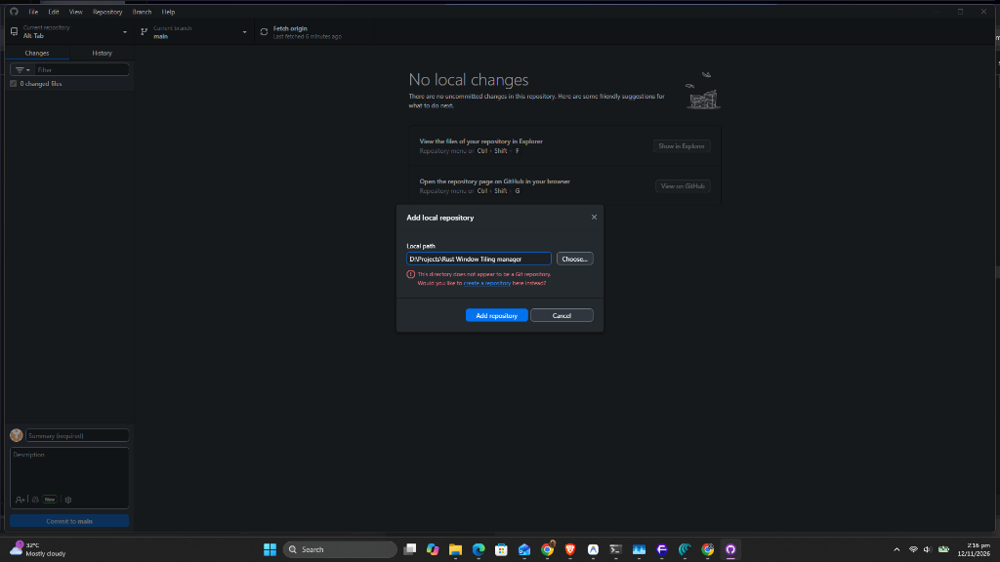 | 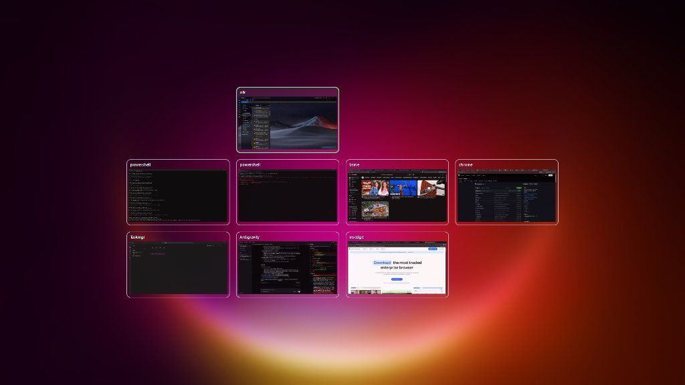 |

---

### 📐 Architectural Concepts & System Mechanics

| 2D Infinite Sparse Lattice Navigation | Niri-Style Cell Stacking & Split |
|:---:|:---:|
| 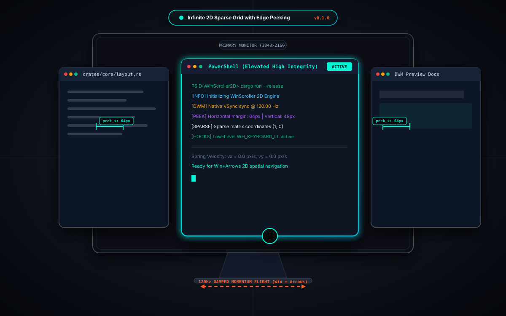 | 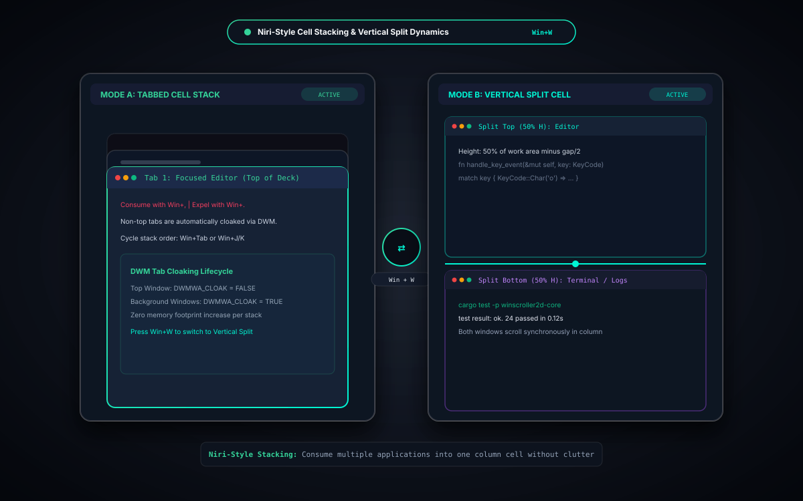 |
| *Unbounded $(X,Y)$ sparse matrix with neighbor peeking* | *Card deck tabs (`Win+W`) vs horizontal split cells* |

| Live Acrylic `Win + O` Overview | Drag-to-Snap Horizontal Split |
|:---:|:---:|
|  | 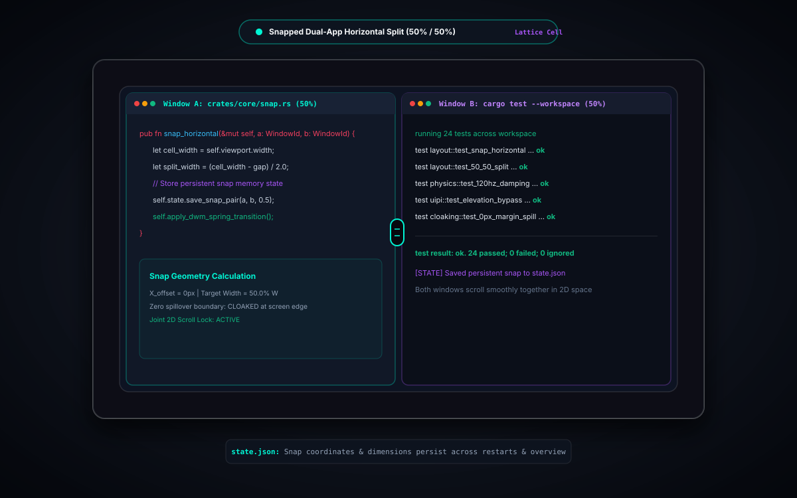 |
| *Frameless DWM thumbnails & dynamic fit-to-display* | *Drag onto window to combine into 50/50 split scroll* |

| 120Hz Mass-Spring Physics ($m\ddot{x} + c\dot{x} + kx = 0$) | Dual Monitor Extended Mode (Zero Spillover) |
|:---:|:---:|
| 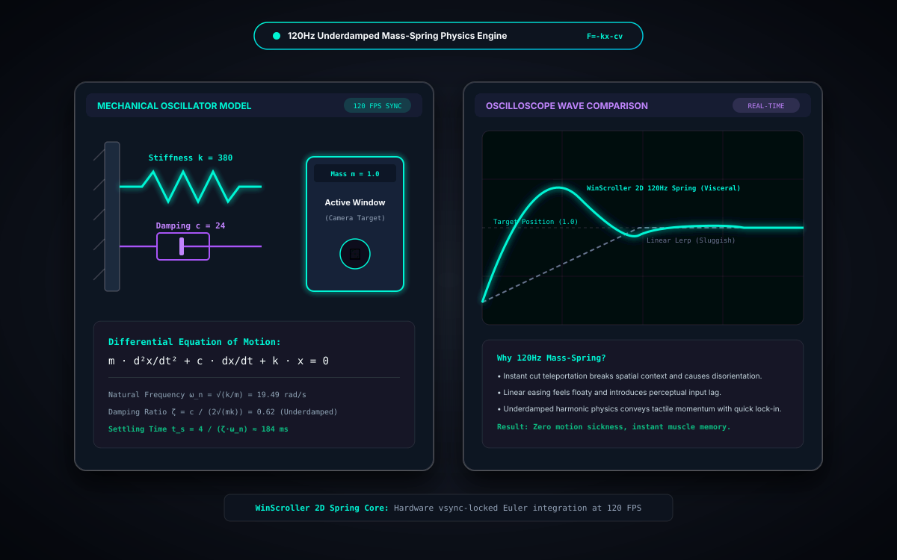 |  |
| *Underdamped harmonic oscillator with zero CPU idle* | *Strict 0px boundary clamping with zero display bleed* |

| 100+ Windows Sparse Matrix Performance | Virtual Desktops & Multi-Monitor Matrix |
|:---:|:---:|
|  | 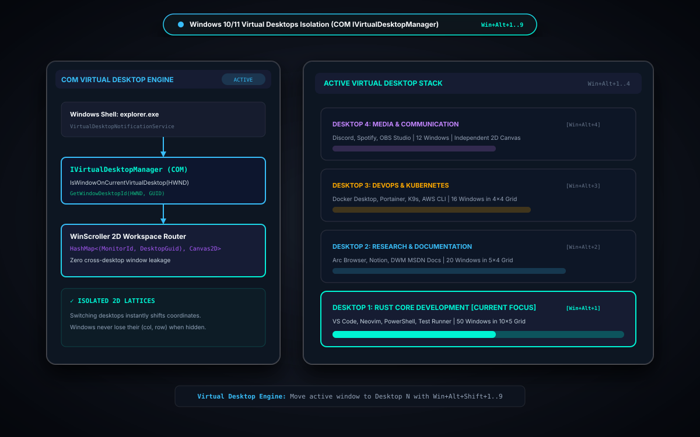 |
| *0.1% CPU & <15MB RAM via DWM cloaking culling* | *COM `IVirtualDesktopManager` per-desktop isolation* |

--- 

## Installation Guide (Step-by-Step)

### Option 1: Direct Download — Latest Prebuilt `.exe` (Fastest, Zero Build Tools)
Every push to `main` automatically builds and publishes the latest standalone, statically linked `winscroller2d.exe` on GitHub Releases:

- **Direct EXE Download:** [**Download latest `winscroller2d.exe`**](https://github.com/fruitsaladwindowsai-zammy/Winscroller-2D/releases/download/latest/winscroller2d.exe)
- **Full Bundle (.zip + docs + SHA256SUMS):** [**Latest Release Page**](https://github.com/fruitsaladwindowsai-zammy/Winscroller-2D/releases/tag/latest)

Or download and run directly via PowerShell:
```powershell
Invoke-WebRequest -Uri "https://github.com/fruitsaladwindowsai-zammy/Winscroller-2D/releases/download/latest/winscroller2d.exe" -OutFile "$HOME\Downloads\winscroller2d.exe"
& "$HOME\Downloads\winscroller2d.exe"
```

> [!TIP]
> **Automated Prerequisite Check & First-Run Setup**:  
> When `winscroller2d.exe` runs, it automatically checks Windows DWM composition, verifies/silently installs the Microsoft Visual C++ x64 Runtime if missing, initializes `%APPDATA%\WinScroller2D\winscroller2d.toml`, and requests UAC elevation. You can also run `winscroller2d.exe --setup` at any time to verify and install both runtime and optional developer prerequisites (`winget`).

---

### Option 2: Build from Source

#### 1. Prerequisites (Clean Windows 10 / 11 Machine)
Windows does **not** include Git or Rust by default. On a new or different PC, open an **Administrator PowerShell** prompt and run:

```powershell
# 1. Install Git for Windows (Enables 'git clone' in PowerShell)
winget install --id Git.Git --accept-package-agreements --accept-source-agreements

# 2. Install Rust toolchain (Rustup)
winget install --id Rustlang.Rustup --accept-package-agreements --accept-source-agreements

# 3. Install MSVC C++ Build Tools (Required to link native Win32/DWM APIs)
winget install --id Microsoft.VisualStudio.2022.BuildTools --override "--wait --quiet --add Microsoft.VisualStudio.Workload.VCTools --includeRecommended"
```

> [!IMPORTANT]
> **Restart Your Terminal**: After running the `winget` commands above, **close and reopen** your PowerShell window so that `git`, `cargo`, and `rustc` environment variables are active on your `PATH`.
>
> *(Optional: Enable long path support in Git: `git config --global core.longpaths true`)*

### 2. Download the Source Code

#### Option A: Clone with Git (Recommended)
```powershell
git clone https://github.com/fruitsaladwindowsai-zammy/Rust-Window-Tiling-manager.git
cd "Rust-Window-Tiling-manager"
```

*If the repository requires GitHub authentication, clone with GitHub CLI or SSH:*
```powershell
# Using GitHub CLI:
winget install --id GitHub.cli
gh auth login
gh repo clone fruitsaladwindowsai-zammy/Rust-Window-Tiling-manager
cd "Rust-Window-Tiling-manager"

# Or using SSH:
git clone git@github.com:fruitsaladwindowsai-zammy/Rust-Window-Tiling-manager.git
cd "Rust-Window-Tiling-manager"
```

#### Option B: Download ZIP (No Git Required)
If you do not have Git installed or cannot use `git clone`, download and extract directly in PowerShell:
```powershell
Invoke-WebRequest -Uri "https://github.com/fruitsaladwindowsai-zammy/Rust-Window-Tiling-manager/archive/refs/heads/main.zip" -OutFile "$HOME\Downloads\winscroller.zip"
Expand-Archive -Path "$HOME\Downloads\winscroller.zip" -DestinationPath "$HOME\Projects"
cd "$HOME\Projects\Rust-Window-Tiling-manager-main"
```

---

### 3. Build & Initialize
```powershell
# Compile with release optimizations
cargo build --release

# Create default configuration at %APPDATA%\WinScroller2D\winscroller2d.toml
.\target\release\winscroller2d.exe --init-config

# Validate configuration syntax
.\target\release\winscroller2d.exe --validate
```

### 4. Run WinScroller 2D
```powershell
.\target\release\winscroller2d.exe
```

> [!NOTE]
> **Automatic Administrator Elevation**:
> When started, WinScroller 2D automatically requests Administrator elevation via Windows UAC if not already running in an elevated prompt. Click **Yes** on the UAC prompt. This gives WinScroller 2D High Integrity Level so its low-level keyboard hooks can intercept shortcuts across **all** windows (including Administrator PowerShell and Task Manager) without being blocked by Windows UIPI.

### 5. Optional: Add to PATH & Run on Windows Startup
To launch or control WinScroller 2D from any terminal:
```powershell
# Copy binary to Cargo bin folder (already in PATH)
Copy-Item .\target\release\winscroller2d.exe "$env:USERPROFILE\.cargo\bin\" -Force
```

To have WinScroller 2D start automatically when Windows boots:
```powershell
# Create startup shortcut in shell:startup
$WshShell = New-Object -ComObject WScript.Shell
$Shortcut = $WshShell.CreateShortcut("$env:APPDATA\Microsoft\Windows\Start Menu\Programs\Startup\WinScroller2D.lnk")
$Shortcut.TargetPath = "$PWD\target\release\winscroller2d.exe"
$Shortcut.WorkingDirectory = "$PWD"
$Shortcut.Save()
```

---

## Updating WinScroller 2D

When updating to the latest version, Windows locks the running `.exe` file. Follow these steps for a clean update:

### Step 1: Gracefully Exit the Running Instance
*Before rebuilding, you must exit any active WinScroller 2D daemon, otherwise `cargo build` will fail with `Access is denied (os error 5)`.*

* Via keyboard: Press **`Win + Shift + Escape`**
* OR via terminal:
  ```powershell
  .\target\release\winscroller2d.exe msg quit
  ```

### Step 2: Pull the Latest Changes
```powershell
git pull origin main
```

### Step 3: Rebuild the Release Binary
```powershell
cargo build --release
```
*(Optional: verify with `cargo test --workspace` to ensure all 24 unit/layout tests pass).*

### Step 4: Restart with Replacement
```powershell
.\target\release\winscroller2d.exe --replace
```

### Step 5: (Optional) Retile or Reset Stale Layout Cache
If updating between releases or if any window appears with outdated dimensions:
```powershell
# Reset all workspaces to standard clean geometry presets
.\target\release\winscroller2d.exe msg retile

# Or delete stale saved state if you want a completely fresh grid
Remove-Item -Force "$env:APPDATA\WinScroller2D\state.json" -ErrorAction SilentlyContinue
```

---

## Why WinScroller 2D?

- **Infinite 2D Sparse Grid** – Organize windows across unbounded `(col, row)` coordinates with neighbor edge peeking (`peek_x`/`peek_y`), 5 spawn modes, hole preservation, and optional empty row/column compaction.
- **Niri-Style Cell Stacking** – Consume (`Win+Comma`) or expel (`Win+Period`) windows inside a cell and toggle horizontal split vs. tabbed stacks (`Win+W`) with DWM cloaking.
- **Dynamic `Win+O` Overview with Drag Snapping** – Fits all active windows into the display view over Gaussian-blurred wallpaper (`pure_blur` / `acrylic_clear` / `none`), displays live DWM thumbnails with bottom-centered app icons, animates highlighted windows, supports drag-and-drop cell reordering (`Shift+Drag` to swap, `Ctrl+Drag` to stack), and lets you drag and drop any window onto another to snap them horizontally (50% / 50% width) side-by-side into one combined view with infinite scrolling between views.
- **Clean Display Borders & Cloaking** – 0px edge peek margin guarantees that non-visible workspace columns and rows are cleanly cloaked with zero leftover title bar slivers or edge artifacts in screen corners.
- **Clean Exit Centering** – Graceful exit (`Win+Shift+Escape` or system tray exit) cleanly uncloaks and centers all applications in the monitor work area.
- **Dual Screen & Multi-Monitor Extended Mode** – Strict display boundaries with zero spillover across monitors or virtual desktops, smart cross-monitor drag transfer, and hardware edge clipping.
- **Per-Monitor & Per-Virtual-Desktop Instances** – Tracks Windows Virtual Desktops via COM `IVirtualDesktopManager` and keeps an independent scrolling workspace per `(monitor, desktop)` pair.
- **Persistent Snap Memory** – Saves snapped window sizes, coordinates, and per-workspace lattice toggles in `state.json` across sibling snaps, overviews, and restarts.
- **Spring Physics & Native Inputs** – Hardware-paced `120 Hz` underdamped springs, Windows 11 `DWMWA_BORDER_COLOR`, debounced hover-focus on edge peeks, Precision Touchpad 3-finger pan / 4-finger overview swipe, `WH_KEYBOARD_LL` Start-Menu suppression, and `winscroller2d msg` named-pipe IPC.

### 🏆 Feature Comparison: WinScroller 2D vs. Other Window Managers

| Feature | WinScroller 2D | Komorebi | GlazeWM | Niri | Windows 11 Snap |
| :--- | :---: | :---: | :---: | :---: | :---: |
| **Target Platform** | **Windows 10 / 11** | Windows 10 / 11 | Windows 10 / 11 | Linux (Wayland only) | Windows 11 |
| **Grid Topology** | **Unbounded 2D Infinite Sparse Canvas** | Screen-bound BSP / Columns | Screen-bound BSP / Columns | 1D Infinite Horizontal Ribbon | 2–4 Static Screen Zones |
| **Live Overview** | **Interactive 2D Acrylic Canvas (`Win+O`)** | ❌ None | ❌ None | Workspaces Overview | Windows Task View (no canvas) |
| **Drag-to-Snap Dual View** | **Drag onto window to combine into split scroll** | ❌ (Keyboard only) | ❌ (Keyboard only) | ❌ | Static 2-split |
| **Smooth Motion** | **120 Hz Underdamped Mass-Spring Physics** | Instant cut / linear lerp | Instant cut / linear lerp | Smooth springs | Fixed OS transition |
| **Admin App Control** | **Automatic UIPI Elevation (Task Mgr, Admin PS)** | Requires service/task | Requires manual elevation | N/A (Root/User) | Full OS integration |
| **Display Boundary Isolation** | **0px Edge Margin (Zero Corner Spillover)** | Border adjustments | Border adjustments | Native Wayland crop | Native OS crop |
| **Runtime Architecture** | **Single Standalone Rust Binary (Zero Deps)** | Multi-process daemon + AHK | Standalone Rust | Wayland compositor | Closed-source OS shell |

---

## Essential Keybindings

| Shortcut | Action |
|----------|--------|
| `Win+Left/Right/Up/Down` | Focus adjacent cell in the 2D grid |
| `Win+Shift+Left/Right/Up/Down` | Move / swap focused window in the 2D grid |
| `Win+Ctrl+Left/Right/Up/Down` | Pan camera independently of focus (`Win+C` centers) |
| `Win+Equal` / `Win+Minus` | Step cell width preset (`Win+Shift+Equal/Minus` for height) |
| `Win+Comma` / `Win+Period` / `Win+W` | Consume into cell / Expel / Toggle split-vs-tabbed stack |
| `Win+O` | Toggle dynamic 2D **Overview** (with drag-to-snap) |
| `Win+F` / `Win+Shift+F` / `Win+Shift+Space` | Maximize cell / Fullscreen / Float window |
| `Win+Alt+1..9` / `Win+PageUp/PageDown` | Switch workspaces (`Win+Alt+Shift+1..9` moves window) |
| `Win+Alt+Left/Right` | Focus monitor (`Win+Alt+Shift+Left/Right` moves window) |
| `Win+Alt+S` / `Win+Alt+L` / `Win+Shift+R` | Open Settings UI / Toggle workspace lattice / Retile |
| `Win+Shift+P` / `Win+Shift+Escape` | Pause-Resume tiling / Exit & restore windows |

Complete keyboard, overview mouse/drag, Precision Touchpad, and tray reference: **[KEYBINDINGS.md](KEYBINDINGS.md)**.

---

## Documentation

| Document | Contents |
|----------|----------|
| [Official Wiki](wiki/Home.md) | Comprehensive guides, core concepts, multi-monitor, admin apps & FAQ |
| [KEYBINDINGS.md](KEYBINDINGS.md) | Complete shortcuts, overview interactions, touchpad gestures & custom binding syntax |
| [CONFIGURATION.md](CONFIGURATION.md) | Complete `winscroller2d.toml` schema, defaults, clamps & window rules |
| [USAGE.md](USAGE.md) | CLI flags, IPC `msg` commands, tray icon & Settings UI guide |
| [RELEASE_NOTES.md](RELEASE_NOTES.md) | Detailed `v0.1.0` release notes |
| [CHANGELOG.md](CHANGELOG.md) | Version changelog |
| [CONTRIBUTING.md](CONTRIBUTING.md) | Workspace structure, testing (`cargo test --workspace`) & PR guidelines |
| [CODE_OF_CONDUCT.md](CODE_OF_CONDUCT.md) | Contributor Covenant v2.1 community standard & pledge |
| [SECURITY.md](SECURITY.md) | Vulnerability disclosure policy & UIPI integrity model |
| [docs/](docs/README.md) | Source for the mdBook GitHub Pages documentation site |

---

## License

MIT © 2024–2026 WinScroller 2D contributors — see [LICENSE](LICENSE).
