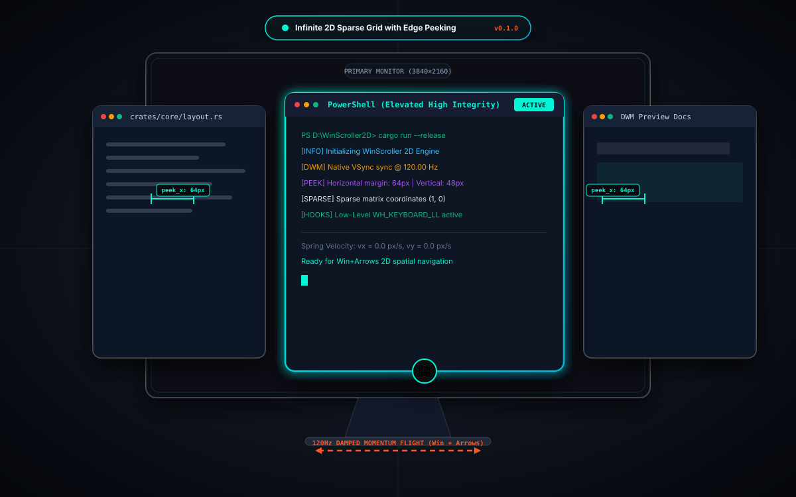

# WinScroller 2D

**A native, lightweight 2D scrolling and tiling window manager for Windows 10/11 written in Rust.**

WinScroller 2D merges **Niri-style** scrolling columns and cell stacks with **Hyprscroll2D** infinite 2D grids and an interactive **Win+O dynamic overview** — powered directly by native Win32, DWM, and HID APIs.

> 🌐 **Interactive Website & Live 2D Simulator**:  
> Experience WinScroller 2D directly in your browser with real-time grid simulation, 120Hz spring physics lab, and interactive configuration studio:  
> [**https://fruitsaladwindowsai-zammy.github.io/Rust-Window-Tiling-manager/**](https://fruitsaladwindowsai-zammy.github.io/Rust-Window-Tiling-manager/)

---

## Visual Architecture Overview

---

## Highlights

- **Infinite 2D Sparse Grid** — Place, swap, and scroll across `(col, row)` coordinates with neighbor edge peeking and five placement strategies.
- **Niri Cell Stacking** — Consume (`Win+Comma`), expel (`Win+Period`), and toggle vertical split vs. tabbed stacks (`Win+W`).
- **Dynamic `Win+O` Overview** — Automatically fits all active windows into the display view with live DWM thumbnails, Gaussian-blurred wallpaper, bottom-centered app icons, smooth front/back depth transitions, drag-and-drop reordering, and a spring-animated red top-right `✕` close button on the highlighted window.
- **Drag-to-Snap Dual View** — Drag any window onto another in `Win+O` overview to fuse them into a 50/50 horizontal split cell that scrolls together as a unit.
- **Hardware-Paced 120Hz Springs** — Underdamped mass-spring-damper camera dynamics with zero CPU spin when at rest.
- **Per-Monitor & Per-Desktop Instances** — Separate scrolling workspace state per physical monitor and per Windows virtual desktop (COM `IVirtualDesktopManager`).
- **Zero Edge Spillover** — 0px margin border enforcement completely prevents peeking windows from leaking across multi-monitor or desktop boundaries.
- **Persistent Snap Memory** — Saves grid coordinates, custom/preset snap proportions, and workspace layout modes in `state.json`.
- **Precision Touchpad & Hover Focus** — 3-finger continuous 2D panning, 4-finger swipe overview toggle, and debounced hover-focus on peeking edge windows.
- **Live Settings & IPC CLI** — Configure via `%APPDATA%\WinScroller2D\winscroller2d.toml` (hot-reloaded), `Win+Alt+S` Settings overlay, or `winscroller2d msg <command>`.

---

## Documentation Roadmap

| Guide | Description |
|-------|-------------|
| [Getting Started](./getting-started.md) | Build prerequisites (`winget`), configuration init, and launch |
| [Keybindings & Gestures](./keyboard-shortcuts.md) | Keyboard chords, overview mouse/drag controls, touchpad gestures & tray actions |
| [Overview Mode (`Win+O`)](./overview-mode.md) | Dynamic overview, live DWM thumbnail pipeline, and drag-to-split snapping |
| [Physics & 120Hz Dynamics](./physics.md) | Mass-spring-damper harmonic oscillator mathematics, VSync pacing & tuning |
| [Multi-Monitor & Extended Displays](./multi-monitor.md) | Strict 0px boundary isolation, cross-screen drag transfer & COM Virtual Desktops |
| [Administrator & Elevated Apps](./admin-apps.md) | Windows UIPI High Integrity Level elevation and UAC handling |
| [Configuration Guide](./configuration.md) | Full `winscroller2d.toml` schema, geometry presets, clamps & window rules |
| [CLI & IPC Scripting](./ipc-scripting.md) | Named-pipe IPC protocol, PowerShell automation & batch commands |
| [Architecture & Internals](./architecture.md) | Workspace crate layout, sparse matrix lattice, and Win32 hook subsystems |
