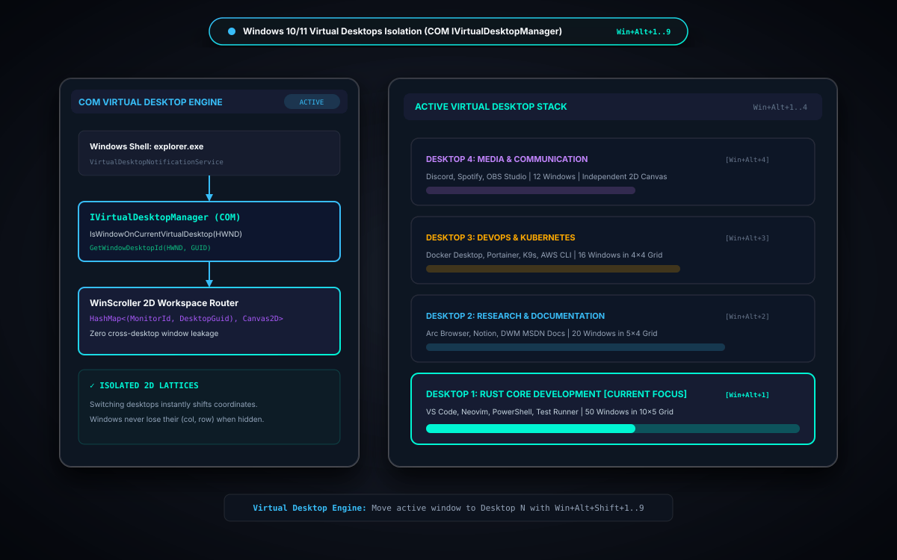

# Multi-Monitor & Extended Displays

WinScroller 2D provides enterprise-grade multi-display management for Windows in extended display mode (`Win + P` > Extend).

---

## 🖥️ Strict Monitor Boundary Enforcement (Zero Edge Spillover)

* **Zero Edge Spillover**: Windows tiling managers often suffer from "edge spillover" where windows peeking on Display 1 leak across the pixel boundary onto Display 2. WinScroller 2D enforces strict hardware coordinate clipping against adjacent monitor bounds. Peeking windows are clamped to their monitor's work area, ensuring zero bleeding onto neighboring screens.
* **Independent Camera & Grid State**: Each physical monitor maintains its own separate camera position `(col, row)` and zoom physics. Scrolling horizontally or vertically on Display 1 does **not** affect or scroll Display 2.
* **Moving Windows Between Displays**:
  * **Shortcut**: Press **`Win + Alt + Shift + Left`** or **`Win + Alt + Shift + Right`** to immediately move the focused application to the adjacent monitor.
  * **Mouse Drag**: Dragging a tiled window past the monitor border automatically detects the destination monitor via `MonitorFromWindow`, transfers the window to that display's active workspace, and retiles both screens smoothly.

---

## 🗂️ Windows 10/11 Virtual Desktops Integration (COM)

WinScroller 2D interfaces directly with the native Windows COM `IVirtualDesktopManager` subsystem:

* **Per-Desktop Workspace Isolation**: Each `(Monitor, VirtualDesktop)` pair forms an independent workspace.
* Switching OS desktops via three-finger touchpad swipe or **`Win + Ctrl + Left / Right`** triggers native GUID change events.
* WinScroller 2D tracks desktop IDs (`GUID`) and synchronizes window placement without losing camera positions or tiled layouts.
* Inactive virtual desktops are automatically cloaked with zero memory footprint or rendering overhead.
