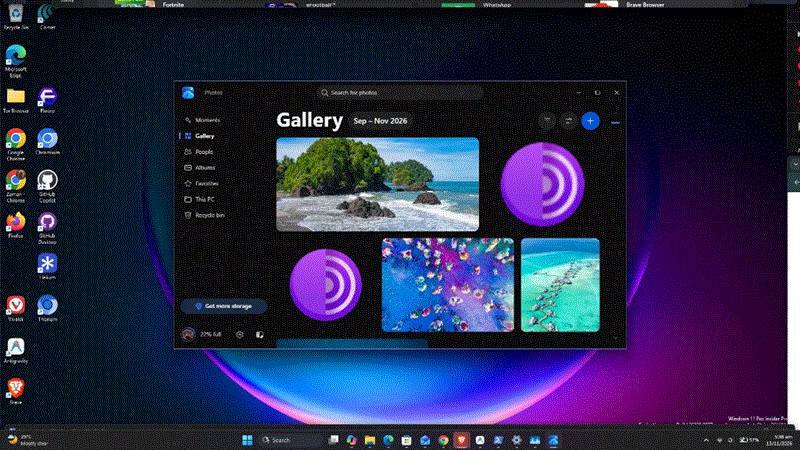
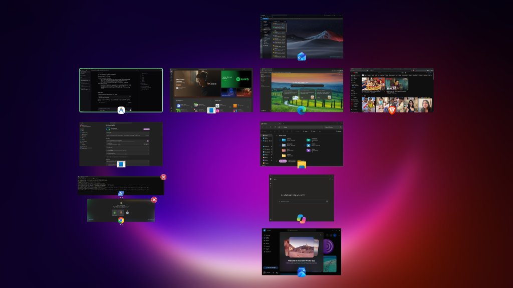
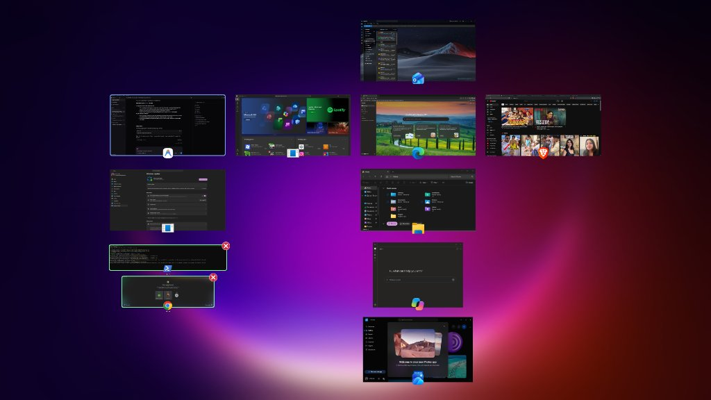
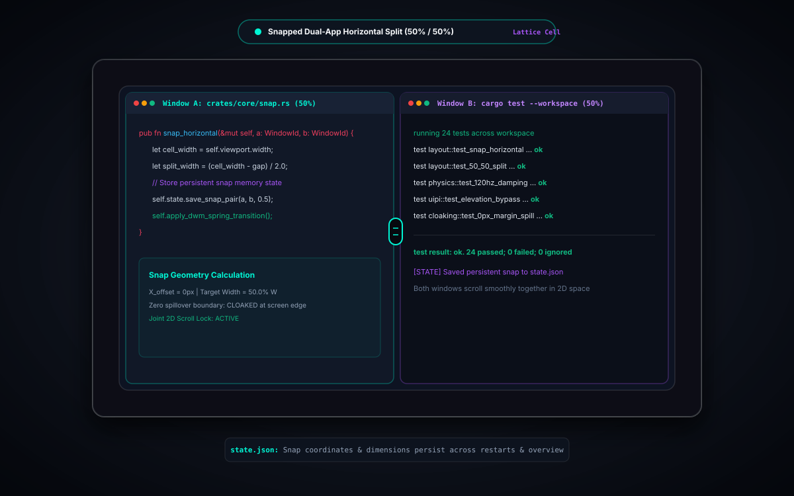
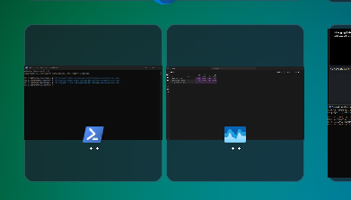

# Overview Mode (`Win+O`)

The **Win+O** overview provides a live, interactive bird's-eye view of your entire 2D coordinate canvas.

---

## 🎬 Live Walkthrough

---

## Visual Design & Architecture

| Live Acrylic Overview | Card Navigation & Selection |
|:---:|:---:|
|  |  |

- **Dynamic Fit-to-Display Layout**: Window thumbnails scale automatically based on the number of open windows so the entire layout fits cleanly within the display view without scrolling.
- **Frameless App Previews + Bottom-Center Icons**: Renders live DWM thumbnails directly over Gaussian-blurred desktop wallpaper (`pure_blur` or `acrylic_clear`) with no opaque card box or titlebar text — displaying each app's icon centered along the bottom edge (plus stack dots when a cell holds multiple windows).
- **Front/Back Transitions**: Pressing **Win+O** animates the active window backward into the grid; clicking a card or pressing `Enter` animates the highlighted window smoothly back to the front.
- **Live Wallpaper Acrylic Filter**: Captures current Windows desktop wallpaper via `SystemParametersInfoW` and computes an in-memory box/Gaussian blur before rendering via DirectComposition.

---

## ✕ Spring-Animated Close Button

- Only the **currently highlighted** card activates the close button (`hit_close_button` + `close_springs`).
- Rendered as a vivid **red circle with a white `✕`** in the **top-right corner** of the card, clamped inside screen bounds (`close_button_rect`).
- Animates in and out with dedicated spring physics and scales slightly when hovered.
- Automatically hides while dragging a card (`active_drag`) to prevent accidental closures during cell moves.

---

## 🔀 Drag-and-Drop Reordering & Horizontal Split Snapping

- **Interactive Dragging**: Dragging a window card shrinks surrounding tiles smoothly and reveals available target grid slots.
- **Move to Empty Slot**: Drop onto any empty coordinate to move the window into that cell.
- **Drag-to-Snap Horizontal Split**: Drop any window card directly onto another window to fuse both together side-by-side ($50\% / 50\%$ width) into a unified view with infinite scroll between views!
- **Swap Windows (`Shift` + Drag)**: Hold **`Shift`** while dropping onto another window to swap their positions.
- **Stack into Cell (`Ctrl` + Drag)**: Hold **`Ctrl`** while dropping onto another window to stack the window into the target cell.

| Snapped Dual-App Horizontal Split View |
|:---:|
|  |

---

## Clean Display Borders & Cloaking Guarantees

1. **Zero Leftover Artifacts**: Windows off the visible screen edges are cleanly cloaked using DWM cloaking (`DWMWA_CLOAK`). No titlebar fragments or 1px window borders linger in corners.
2. **Clean Centering on Exit**: Pressing `Win+Shift+Escape` uncloaks all windows and restores them centered on the physical screen without any leftover gaps.
