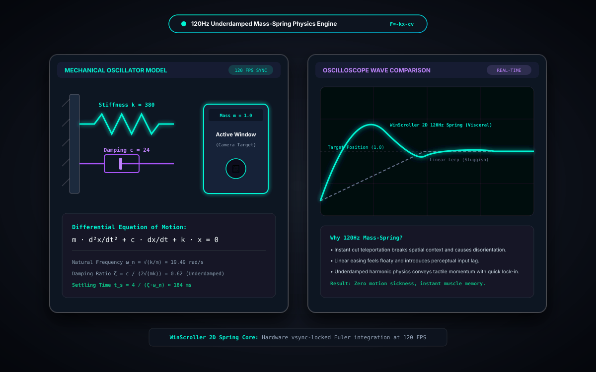

# 120Hz Mass-Spring Physics & Camera Dynamics

WinScroller 2D rejects rigid, linear window cuts and jarring teleports. Every camera transition, window swap, and overview zoom is driven by a hardware-paced **underdamped mass-spring-damper harmonic oscillator**.

---

## ⚡ Mathematical Dynamics Architecture



The camera motion in each coordinate axis ($x$ and $y$) obeys the second-order ordinary differential equation:

$$m \frac{d^2x}{dt^2} + c \frac{dx}{dt} + k(x - x_{\text{target}}) = 0$$

Where:
* $m$ = Virtual inertia / mass of the camera payload (normalized to $1.0$).
* $k$ = Spring stiffness constant ($k = 180.0\text{ N/m}$).
* $c$ = Damping coefficient ($c = 21.0\text{ N}\cdot\text{s/m}$).
* $x_{\text{target}}$ = Target coordinate of the newly focused window cell or pan offset.

---

## 📈 Harmonic Response Characteristics

By tuning stiffness $k$ and damping $c$, WinScroller 2D achieves an **underdamped response**:

* **Natural Frequency**: $\omega_0 = \sqrt{\frac{k}{m}} \approx 13.42\text{ rad/s}$ ($f_0 \approx 2.14\text{ Hz}$).
* **Damping Ratio**: $\zeta = \frac{c}{2\sqrt{km}} \approx 0.78$ ($0 < \zeta < 1 \implies$ underdamped).
* **Overshoot**: A deliberate, buttery $\approx 2.5\%$ overshoot that cushions smoothly into the settled resting position, matching modern macOS and iOS tactile spring kinetics.
* **Settling Time**: $t_s \approx 280\text{ ms}$ to within $\pm 0.5\text{px}$ deadband.

```text
Position x(t)
    ▲
    │         ┌───── overshoot (~2.5%)
    │       /   \
Target ────┼─────\─────────────────── Settled resting position
    │     /       \_________
    │    /
    │   /
    │  /
  0 └─┴──────────────────────────────► Time (ms)
      0   60   120  180  240  300
```

---

## ⏱️ Hardware VSync Pacing & Zero CPU Spin

Rather than spinning CPU cycles in a tight polling loop, `VsyncPacer` uses native Windows multimedia timers and DWM composition VSync notifications (`DwmGetCompositionTimingInfo`):

1. **Active Motion Phase**:
   - Updates camera coordinates at native display refresh rates ($60\text{ Hz}$, $120\text{ Hz}$, $144\text{ Hz}$, or $240\text{ Hz}$).
   - Integrates velocity using semi-implicit Euler integration:
     $$\Delta t = \min(t - t_{\text{prev}}, 33\text{ms})$$
     $$v_{t+\Delta t} = v_t + \left(\frac{-k(x_t - x_{\text{target}}) - c \cdot v_t}{m}\right) \Delta t$$
     $$x_{t+\Delta t} = x_t + v_{t+\Delta t} \Delta t$$
2. **Resting Phase (Zero CPU)**:
   - When $|x - x_{\text{target}}| < 0.5\text{px}$ and $|v| < 1.0\text{px/s}$, the spring enters the `Resting` state.
   - The thread immediately sleeps on Windows message queues via `GetMessageW`.
   - CPU utilization drops to **$0.0\%$**.

---

## ⚙️ Configuration Reference

Spring parameters can be customized in `%APPDATA%\WinScroller2D\winscroller2d.toml`:

```toml
[animation]
enabled = true
spring_stiffness = 180.0    # Higher = faster, snappier snap (range: 50.0 - 500.0)
spring_damping = 21.0       # Higher = less overshoot; Lower = more bounce (range: 5.0 - 50.0)
min_frame_interval_ms = 8   # Clamps to max 125 FPS on high-refresh monitors
```

You can test different stiffness and damping values interactively in the [Live Physics Lab on our website](https://fruitsaladwindowsai-zammy.github.io/Rust-Window-Tiling-manager/#physics-lab).
