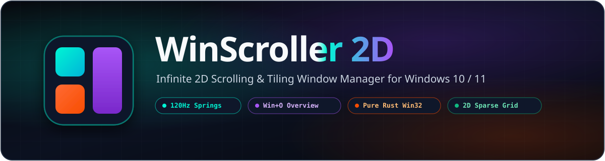

# Welcome to the WinScroller 2D Wiki

**WinScroller 2D** is an infinite 2D scrolling and tiling window manager for Windows 10 and 11. It brings the intuitive horizontal strip mechanics of [Niri](https://github.com/YaLTeR/niri) and [PaperWM](https://github.com/paperwm/PaperWM), the 2D infinite workspace lattice of [Hyprscroll2D](https://github.com/hyprwm), and a live visual `Win+O` Overview mode to power users and keyboard-driven developers on Windows.

---

## 🧭 Navigation & Guides

| Category | Pages |
|----------|-------|
| 🚀 **Getting Started** | • [[Getting Started\|Getting-Started]]<br>• [[Core Concepts\|Core-Concepts]]<br>• [[Keyboard Shortcuts\|Keyboard-Shortcuts]] |
| 🎮 **Controls & Gestures** | • [[Touchpad Gestures\|Touchpad-Gestures]]<br>• [[Overview Mode (Win+O)\|Overview-Mode]]<br>• [[CLI & IPC Scripting\|CLI-and-IPC-Scripting]] |
| 🖥️ **Displays & Workspaces** | • [[Multi-Monitor & Virtual Desktops\|Multi-Monitor-and-Virtual-Desktops]]<br>• [[Administrator & Elevated Apps\|Administrator-and-Elevated-Apps]] |
| ⚙️ **Customization** | • [[Configuration Guide\|Configuration-Guide]]<br>• [[Window Rules & Exclusions\|Window-Rules-and-Exclusions]] |
| 🛠️ **Deep Dive & Support** | • [[Architecture & Internals\|Architecture-and-Internals]]<br>• [[Troubleshooting & FAQ\|Troubleshooting-and-FAQ]] |

---

## 🌟 Key Highlights

```text
 ┌──────────────────────────────── 2D Infinite Workspace ────────────────────────────────┐
 │                                                                                        │
 │      (0, -1) Docs                (1, -1) Notes                                         │
 │   ┌─────────────────┐         ┌─────────────────┐                                      │
 │   │ API Reference   │         │ Task Scratchpad │                                      │
 │   └─────────────────┘         └─────────────────┘                                      │
 │                                                                                        │
 │       (0, 0) Code                (1, 0) Terminal              (2, 0) Browser           │
 │   ┌─────────────────┐         ┌─────────────────┐          ┌─────────────────┐         │
 │   │ Editor (VSCode) │ ◄──────►│ Focus (Active)  │  ◄──────►│ Brave / Edge    │         │
 │   └─────────────────┘         └─────────────────┘          └─────────────────┘         │
 │                                        ▲                                               │
 │                                        │                                               │
 │                                        ▼                                               │
 │                                  (1, 1) Profiler                                       │
 │                               ┌─────────────────┐                                      │
 │                               │ Resource Monitor│                                      │
 │                               └─────────────────┘                                      │
 └────────────────────────────────────────────────────────────────────────────────────────┘
```

1. **Infinite 2D Sparse Grid (`col, row`)**:
   Organize windows across unbounded horizontal columns and vertical rows. Never run out of screen space—navigate with `Win + Arrows` or pan smoothly with Precision Touchpad gestures.
2. **Dynamic `Win+O` Overview with Drag-to-Snap**:
   Zoom out instantly to see every open application on your monitor over a blurred desktop background. Drag any window onto another to snap them side-by-side into a unified dual-app view with 50/50 split and infinite scroll.
3. **True Dual-Screen & Multi-Monitor Extended Mode**:
   Windows are strictly bound to their parent display work area with zero cross-monitor spillover or visual artifacts. Dragging across displays or pressing `Win+Alt+Shift+Left/Right` seamlessly transfers windows between monitors.
4. **Seamless Administrator & Elevated Window Support**:
   Runs with automatic UAC elevation and a permissive IPC pipe descriptor. Low-level keyboard hooks operate at High Integrity Level, intercepting navigation hotkeys before Windows Explorer can trigger Aero Snap.
5. **Spring Physics & Hardware Pacing**:
   Transitions and camera pans are calculated via underdamped spring physics stepped at 120Hz VSync for buttery smooth responsiveness.
6. **Zero Cloak Slivers & Clean Exit**:
   Clean edge clamping ensures offscreen windows are fully cloaked without 1px boundary leaks or leftover titlebar artifacts. Exiting (`Win+Shift+Escape`) restores and centers all windows on the desktop.
