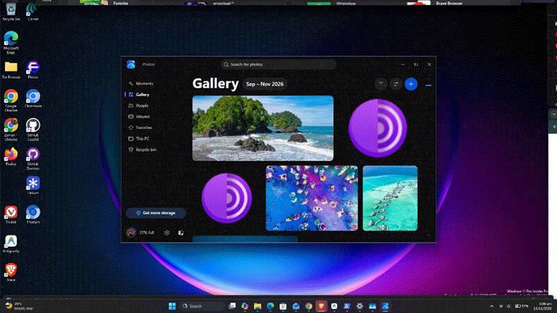
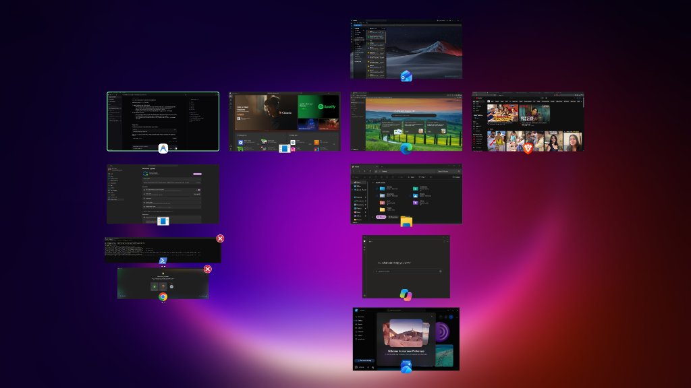
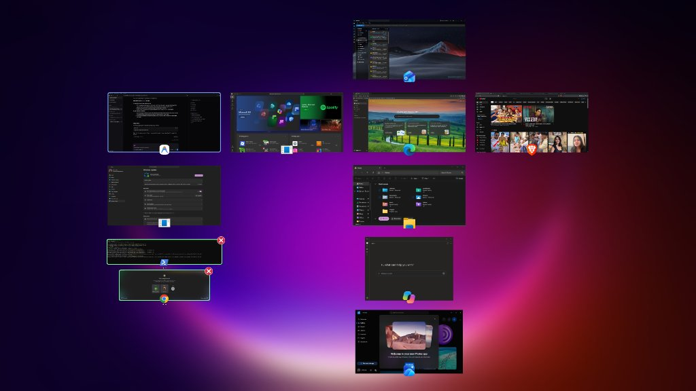
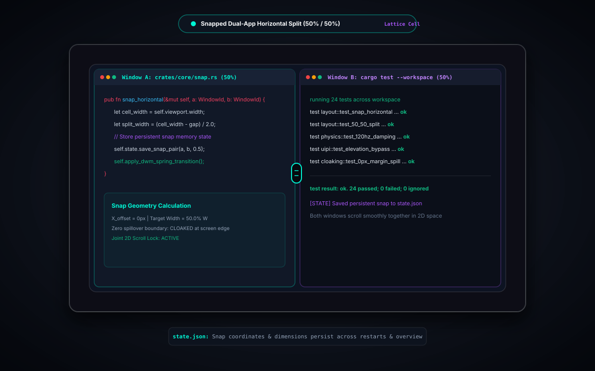
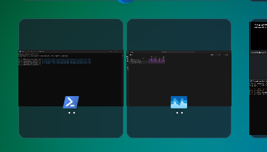

# Overview Mode (`Win + O`)

**Overview Mode** (`Win + O`) provides a bird's-eye view of your entire 2D workspace, inspired by macOS Mission Control, GNOME Overview, and Windows Task View, but customized specifically for infinite 2D tiling.

---

## 🎨 Visual Aesthetics & Layout

When you press **`Win + O`**:

| Live Acrylic Overview | Overview Selection & Cards |
|:---:|:---:|
|  |  |

* **Wallpaper Acrylic Blur**: A snapshot of your current wallpaper is smoothly blurred using native GDI/DWM Gaussian filtering (`pure_blur` or `acrylic_clear`), free of washed-out white veils or overly dark tints.
* **Live DWM Thumbnails**: Applications display real-time live video thumbnails via Windows Desktop Window Manager (`DwmRegisterThumbnail`).
* **Fallback Card Engine**: If an application prevents DWM thumbnail sharing, WinScroller 2D renders a high-dpi dark card with title text and application icon so no app is ever missing.
* **Badged App Icons**: High-resolution icons extracted directly from the executable (`ExtractIconExW` / `SHGetFileInfoW`) are rendered floating at the bottom center of each card.
* **One-Click Close Button**: Hovering over any card reveals a smooth red close button in the top-right corner to close applications directly from the overview.

---

## 🖱️ Drag-and-Drop & Horizontal Split Snapping

Overview mode includes full mouse interaction designed for effortless organization:

### 1. Reordering Cells
* Click and drag any window card to an empty grid slot to move it to that coordinate.
* Dragging a card onto another unoccupied coordinate rearranges the 2D lattice.

### 2. Drag-to-Snap Dual-App Split View
* **How it works**: Grab any window thumbnail and **drop it directly onto another window**.
* **Result**: Both applications immediately snap together into a **horizontal side-by-side view** ($50\% / 50\%$ width each) within the same view!
* **Infinite Scroll**: You can now scroll smoothly in 2D between your dual-app views, single-app views, and terminal stacks!

| Dual-App Snapped Horizontal Split View |
|:---:|
|  |

* **Directional Placement**:
  * Dropping on the **left half** of the target window places the dragged app on the left.
  * Dropping on the **right half** places the dragged app on the right.

### 3. Swapping & Stacking
* Hold **`Shift`** while dropping a window onto another window to **swap** their positions.
* Hold **`Ctrl`** while dropping a window onto another window to **stack** the application into the target cell.

---

## ⌨️ Overview Controls

| Action | Control | Description |
|--------|---------|-------------|
| **Toggle Overview** | `Win + O` | Open or close the overview. |
| **Select & Zoom In** | `Left Click` or `Enter` | Focus the chosen window, closing overview and smoothly panning camera to it. |
| **Navigate Grid** | `Left / Right / Up / Down` | Move highlight cursor across cards. |
| **Close Window** | Click `[X]` button or `Delete` | Gracefully close the selected window. |
| **Cancel / Exit** | `Escape` | Close overview without changing window position. |
